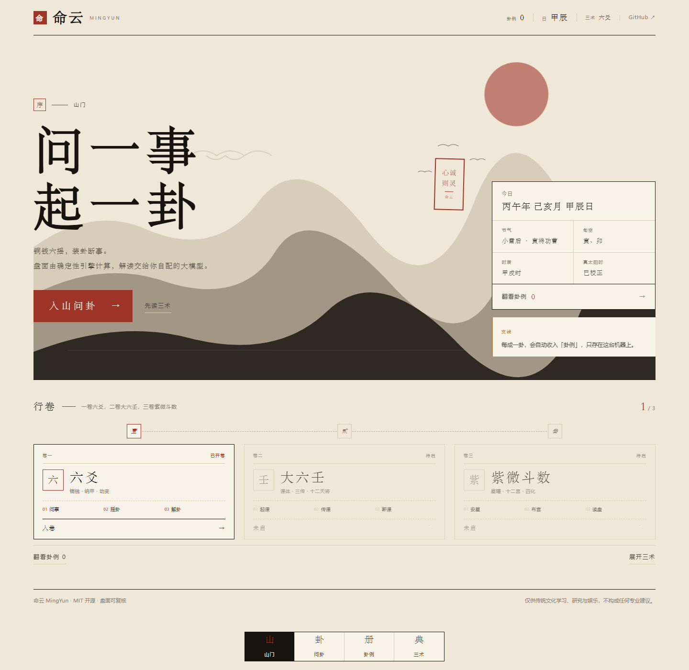
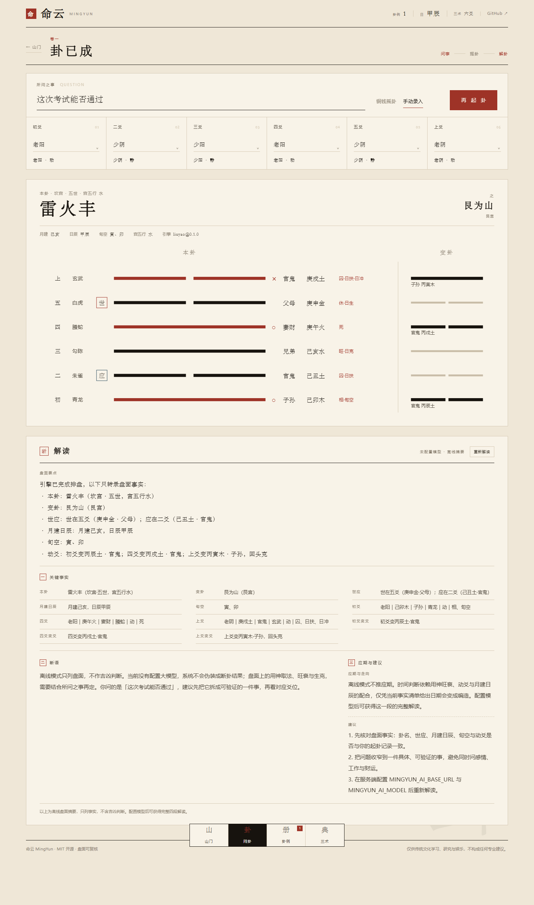
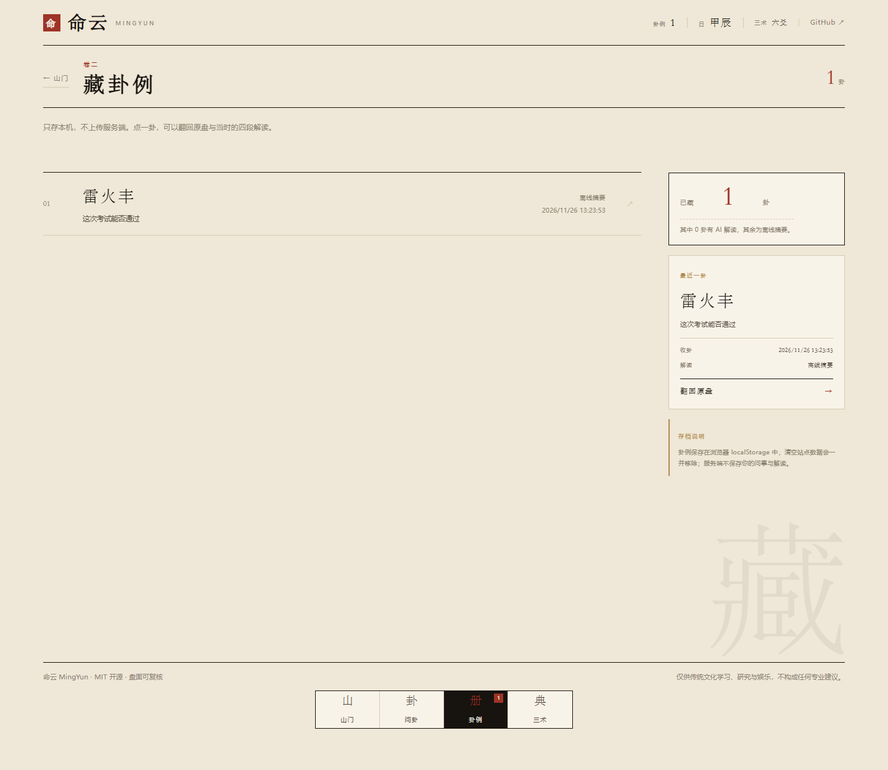
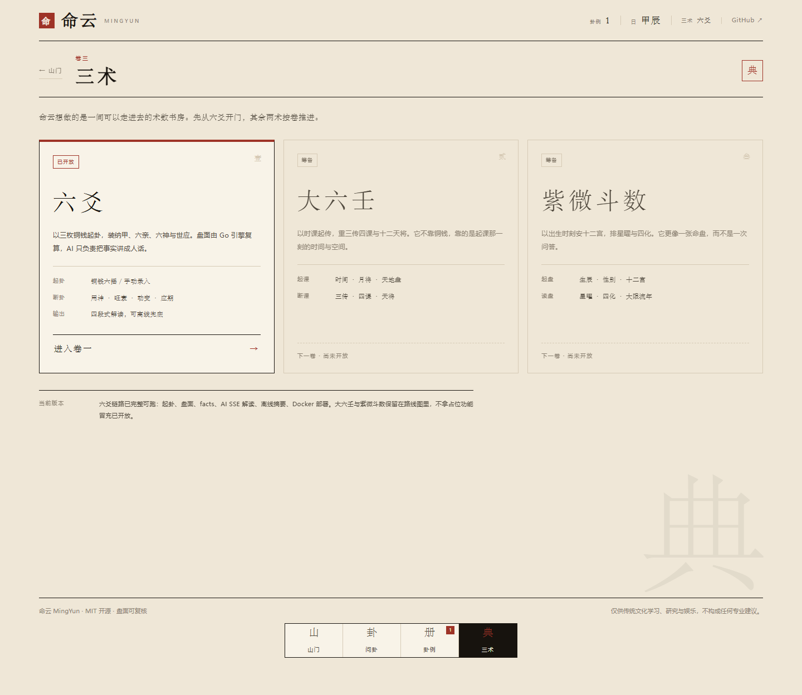
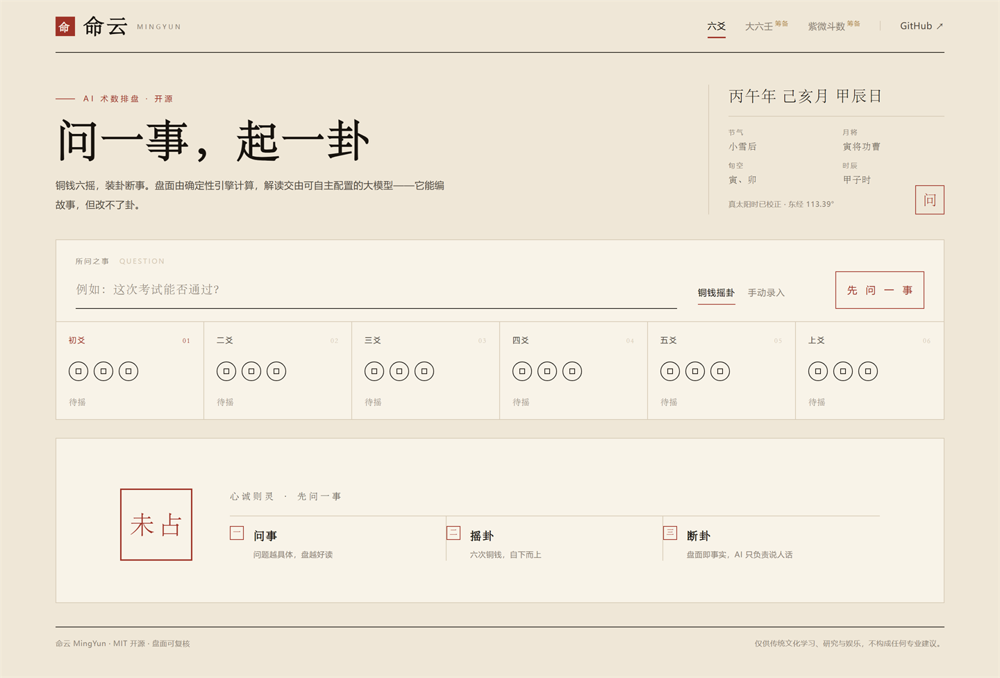

# 命云 MingYun

[](https://github.com/huayuehua15-netizen/mingyun/actions/workflows/ci.yml)

开源的 AI 术数排盘平台。盘面由确定性 Go 引擎计算，解读交给可自主配置的 OpenAI 兼容模型；没有配置模型时，站点仍可排盘，并给出只列事实、不判吉凶的离线摘要。

**技术栈**：Vue 3 + TypeScript / Go 1.25 / Docker Compose / GitHub Actions

## 当前状态

当前可用的是**六爻**一条完整链路：铜钱摇卦（一爻一摇）或手动录入 → Go 复算排盘 → 盘面 facts → AI 四段流式解读 / 离线摘要。大六壬、紫微斗数已在数据契约与路线图中预留，引擎尚未实现。

| 模块 | 状态 |
|---|---|
| `paipan/calendar` 历法层（干支、节气、月将、旬空、真太阳时、子初换日） | ✅ |
| `paipan/liuyao` 六爻（八宫、纳甲、六亲、六神、世应、伏神、旺衰、动变） | ✅ v0.1.0 |
| `apps/api` 单二进制（`serve` / `calendar` / `paipan`） | ✅ |
| HTTP API：排盘、盘面详情、列表、历法、能力清单、SSE 解读 | ✅ |
| `apps/web` 游戏化四场景（山门 / 案上起卦 / 藏卦例 / 三术）、一爻一摇、逐爻生长、SSE 解读 | ✅ |
| AI 解读（OpenAI 兼容 SSE、四段输出、离线兜底） | ✅ |
| Docker Compose（API + Nginx 静态站） | ✅ |
| `paipan/daliuren` 大六壬 / `paipan/ziwei` 紫微斗数 | ⏳ |
| PostgreSQL / Redis 持久化、账号与额度 | ⏳ |

> 盘面目前存在内存里，API 重启即丢。生产部署前请先接 Postgres，或把「重启丢盘」写进你的使用说明。

## 页面

界面按 PC 游戏的方式分成四幕：山门、案上起卦、藏卦例、三术。首页把三术排成三卷行卷路线，卷一六爻已开卷，后两卷待启；底部导航固定在手边，纸本、朱砂、水墨山景与盘面保持同一套视觉；没有渐变、发光和 3D。

山门与三卷行卷：



案上起卦：问事、铜钱六摇、盘面、四段解读：



藏卦例：只存在浏览器 localStorage，点一卦可以翻回原盘：



三术：六爻已开放，大六壬、紫微斗数按卷推进：



> 截图里的解读是未配置模型时的离线摘要：四段结构保留，只列盘面事实、不判吉凶。配置模型后会走同一条 SSE 链路，改为四段流式解读。

早期纸本界面的未占态与逐爻生长：




一次摇卦的三枚铜钱动画（GIF 为慢放）：


完整盘面与四段解读示例：


> `result-ai-demo.png` 是本地 mock 模型跑通的流式四段演示，不代表具体模型的固定文风。

## 快速开始

### Docker Compose（推荐）

```
cp .env.example .env
# 改 .env 里的 APP_SECRET；要接模型再填 MINGYUN_AI_*
docker compose up --build
```

打开 <http://localhost:8080>。Nginx 托管前端，并把 `/api/` 反代到 API 容器；API 不单独暴露端口。SSE 已关闭代理缓冲，解读是逐字出现的。

只想跑离线排盘，不填任何 `MINGYUN_AI_*` 即可。

> 如果 `docker compose build` 卡在 Docker Hub 的 TLS handshake timeout，在 `.env` 里把 `GO_IMAGE` / `ALPINE_IMAGE` / `NODE_IMAGE` / `NGINX_IMAGE` 换成可访问的镜像源（`.env.example` 里有 DaoCloud 示例），或先手动 `docker pull` 对应镜像并 `docker tag` 成默认名。Compose 已把四个基础镜像都做成了 build arg。

### 本地开发

需要 Go 1.25+、Node 22+。

```
# 终端 1：API
cd apps/api
go run ./cmd/mingyun serve -addr :8080

# 终端 2：前端
cd apps/web
npm ci
npm run dev
```

Vite 默认把 `/api` 代理到 `http://localhost:8080`；需要换目标时：

```
VITE_API_TARGET=http://localhost:18080 npm run dev
```

### 只跑 API / 命令行

```
cd apps/api
go test ./...
go build -o ../bin/mingyun ./cmd/mingyun

# 排一张六爻盘（1 为背，自下而上六组）
../bin/mingyun paipan -summary -coins 111,110,100,000,111,100 -question "这次考试能否通过"

# 查历法
../bin/mingyun calendar -date 2026-11-25 -time 14:30 -lon 113.39
```

## 接入模型

服务端只读环境变量，不把 Key 下发到浏览器。任何 OpenAI 兼容的 `/chat/completions` 流式接口都能接。

| 变量 | 说明 | 默认 |
|---|---|---|
| `MINGYUN_AI_BASE_URL` | 例如 `https://api.deepseek.com/v1`、`http://host.docker.internal:11434/v1` | 空 |
| `MINGYUN_AI_API_KEY` | 本地模型可留空 | 空 |
| `MINGYUN_AI_MODEL` | 模型名，如 `deepseek-chat`、`qwen-plus` | 空 |
| `MINGYUN_AI_TIMEOUT` | 单次请求超时，Go duration | `90s` |
| `MINGYUN_AI_MAX_TOKENS` | 输出上限，最大 8192 | `1200` |
| `MINGYUN_AI_TEMPERATURE` | 0–2 | `0.5` |

`BASE_URL` 与 `MODEL` 同时非空才启用在线解读；否则走 `offline-rulebook@0.1` 离线摘要。

几个可直接用的组合：

```
# DeepSeek
MINGYUN_AI_BASE_URL=https://api.deepseek.com/v1
MINGYUN_AI_MODEL=deepseek-chat
MINGYUN_AI_API_KEY=sk-...

# 通义千问 DashScope 兼容模式
MINGYUN_AI_BASE_URL=https://dashscope.aliyuncs.com/compatible-mode/v1
MINGYUN_AI_MODEL=qwen-plus

# 本地 Ollama（Docker 里访问宿主机）
MINGYUN_AI_BASE_URL=http://host.docker.internal:11434/v1
MINGYUN_AI_MODEL=qwen2.5:7b
```

> 公开部署且配置了付费 Key 时，请在 Nginx 或网关上加限流/鉴权。当前 API 没有账号体系，解读接口是开放的。

## 解读是怎么做的

1. Go 引擎只产出 `facts`：卦名、宫位、世应、月建日辰、旬空、六爻纳甲六亲六神动静、动爻变爻、伏神。AI 不排盘、不补爻。
2. 提示词把 facts 原样列出，把用户问题包在 `<<<USER_QUESTION>>>` 里，声明为数据而非指令，并固定四段输出：`盘面要点 / 断语 / 应期与走向 / 建议`。
3. `POST /api/v1/charts/{id}/interpret` 用 SSE 返回 `meta / delta / usage / done / error`；前端用 `fetch` + `ReadableStream` 解析，逐字渲染。
4. 没有模型时，同一路由返回离线摘要：四段结构保留，但明确不判吉凶、不推应期。

```
curl -N -X POST "localhost:8080/api/v1/charts/{chart_id}/interpret" \
  -H 'Content-Type: application/json' \
  -d '{"question":"这次考试能否通过","style":"plain"}'
```

## API

响应统一信封 `{code, message, data, request_id, server_time}`，错误码见 `docs/05`。

| 方法 | 路径 | 说明 |
|---|---|---|
| POST | `/api/v1/charts/liuyao/cast` | 起卦：`mode=coin` 传 `coins` 六组三枚，或 `mode=manual` 传 `lines` |
| GET | `/api/v1/charts/{id}` | 完整盘面（含全部 facts） |
| GET | `/api/v1/charts?limit=10` | 盘面列表 |
| GET | `/api/v1/meta/capabilities` | 术数能力清单 |
| GET | `/api/v1/meta/calendar` | 历法上下文 |
| POST | `/api/v1/charts/{id}/interpret` | SSE 首轮解读 |

排一张盘：

```
curl -s -X POST localhost:8080/api/v1/charts/liuyao/cast \
  -H 'Content-Type: application/json' \
  -d '{"mode":"coin","question":"这次考试能否通过"}'
```

服务端用 `crypto/rand` 摇卦时，响应会带 `entropy.backs` 与 `entropy_proof`，可复核随机记录；前端一爻一摇时，六组背数由浏览器 CSPRNG 产生，提交后 Go 用同一规则复算，避免前端直接决定卦象。

## 目录

| 路径 | 说明 |
|---|---|
| `paipan/` | 排盘引擎，独立 Go module |
| `paipan/calendar/` | 三术共用历法 |
| `paipan/liuyao/` | 六爻装卦与排盘 |
| `paipan/schema/` | Chart / Fact / Method 契约 |
| `apps/api/` | Go 服务：HTTP、熵源、AI、内存存储 |
| `apps/api/internal/ai/` | OpenAI 兼容客户端、提示词、离线摘要 |
| `apps/web/` | Vue 3 前端、Nginx 镜像 |
| `docs/` | 产品、架构、算法、API、AI、前端、部署、合规、路线图 |

## 文档

先读 `docs/README.md`。重点：

- `docs/03-排盘算法规格.md`：历法与六爻规则
- `docs/05-API接口契约.md`：信封、错误码、SSE
- `docs/06-AI解读与提示词工程.md`：四段输出、facts 预算、校验与评测
- `docs/09-合规与风险.md`：公开部署的合规边界

## 路线图

- M1：六爻排盘、API、前端、Docker、AI 解读（当前）
- M2：Postgres 持久化、账号与额度、解读缓存、分享页
- M3：大六壬
- M4：紫微斗数
- M5：古籍 RAG、流年报告、评测集

## 许可

MIT，详见 `LICENSE`。

本项目仅供传统文化学习、研究与娱乐使用，不构成医疗、投资、法律或婚姻决策建议。公开部署时，运营者需自行承担所在地区的合规义务，详见 `docs/09-合规与风险.md`。
