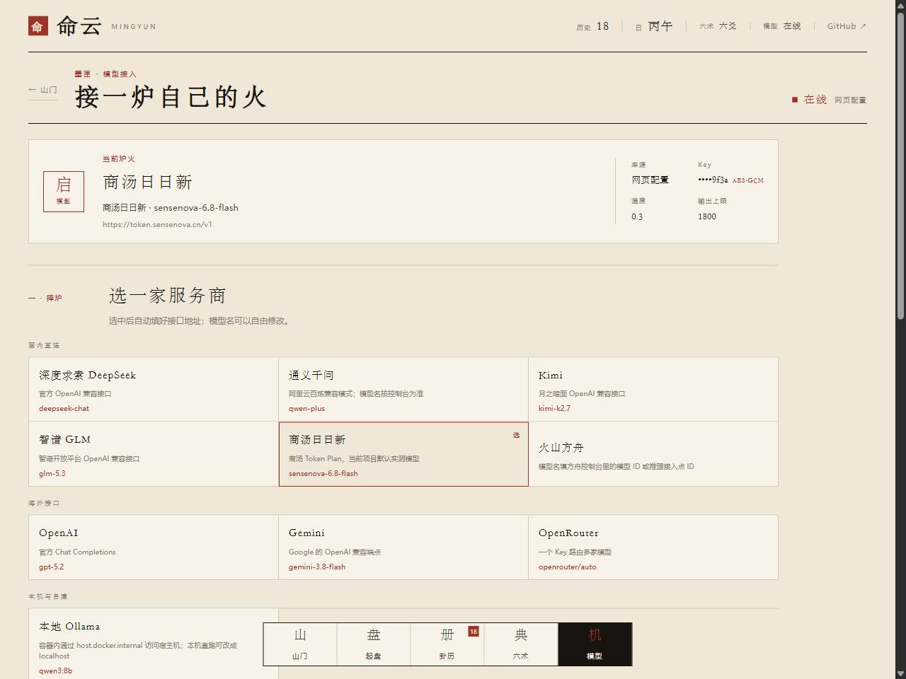
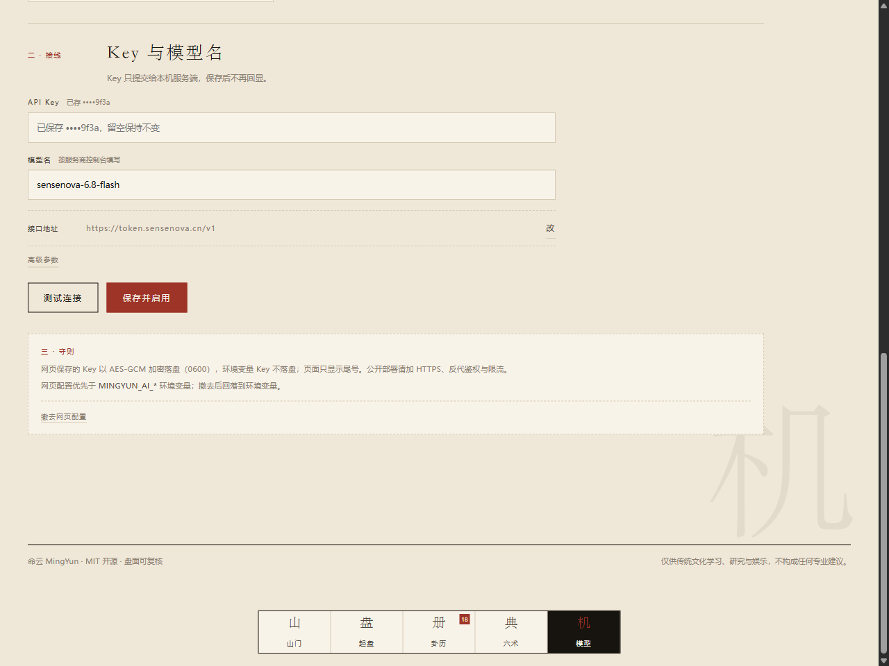
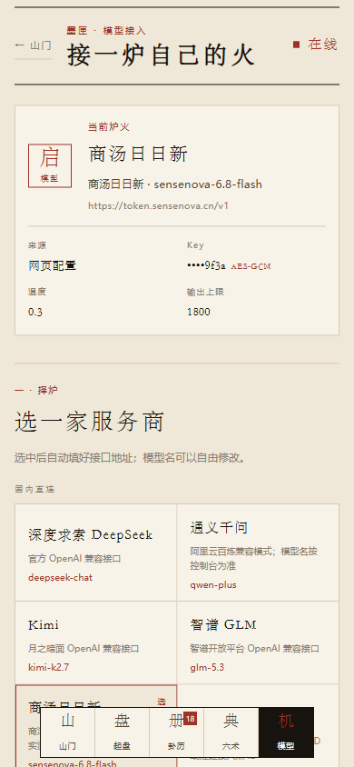

# 12 · 模型中心与数据持久化

> 本文描述当前仓库已经落地的模型接入与数据落盘方案。它不是“以后要做”的路线图，而是 `apps/api`、`apps/web` 与 Compose 三层代码的现状说明。

## 1. 从“改环境变量”到“网页里换一炉火”

早期版本只有一个模型入口：部署前在 `.env` 里填 `MINGYUN_AI_BASE_URL`、`MINGYUN_AI_API_KEY`、`MINGYUN_AI_MODEL`，改模型就要改部署并重启。这个方式对自部署够用，但有两个明显问题：

1. 用户在网页上看不到当前用的是哪家模型、哪个模型名，也无法在换模型前确认 Key 是否有效。
2. 每次试一个新模型都要走一次“改文件 → 重建 / 重启 → 再打开页面”的循环，项目看起来像一个只能跑一次的 demo。

模型中心把这条链路缩短为：**选服务商 → 填 Key 与模型名 → 测试连接 → 保存并启用**。保存后运行时客户端立即替换，不需要重启 API；网页只显示 Key 的末四位，不把明文 Key 回传到浏览器。

## 2. 配置优先级与生命周期

`SettingsStore` 是唯一的模型配置入口，优先级固定为：

```
data/ai-settings.json  >  MINGYUN_AI_* 环境变量  >  未接入
```

| 状态 | `source` | 行为 |
|---|---|---|
| 网页保存过配置 | `file` | 读写 `ai-settings.json`；API 重启后仍然生效 |
| 只配置了环境变量 | `env` | 文件不存在时读取 `MINGYUN_AI_*`；网页可以覆盖 |
| 两者都没有 | `none` | 排盘照常，解读走离线摘要 |
| `MINGYUN_MODEL_SETTINGS=off` | — | 设置接口只读，`PUT/DELETE` 返回 403 |

“撤去网页配置”不是清空成未接入，而是删除 `ai-settings.json` 并回退到环境变量。这样用户不会因为一次误操作把已经部署好的 Key 弄丢。

### 2.1 保存与回滚

- 写入前先更新内存，再写临时文件，`Chmod 0600` 后 `Rename` 到目标路径；目录权限 `0700`。
- 落盘失败时把内存配置与 `source` 回滚到保存前的值，不会出现“接口说保存成功、实际重启后又变回去”。
- 配置文件损坏时启动会报错；主程序会警告并退化为内存存储，不会带着坏配置静默运行。

### 2.2 API Key 加密落盘

`ai-settings.json` 不保存明文 Key。文件版本 2 的结构是：

```json
{
  "version": 2,
  "settings": { "api_key": "" },
  "api_key_cipher": "base64(nonce + AES-GCM 密文)"
}
```

- 算法：AES-256-GCM，随机 12 字节 nonce，附加认证数据固定为 `mingyun-ai-settings-v1`。
- 密钥优先从 `APP_SECRET` 派生：至少 16 字节，用 HMAC-SHA256 加 `mingyun/ai-settings/v1` 上下文生成 32 字节密钥。占位值 `change-me-in-production-please` 不当作有效密钥。
- 没设置有效的 `APP_SECRET` 时，启动会在数据目录生成 `ai-settings.key`（32 字节、`0600`、`0700` 目录），用它加密。这样网页保存仍然可用，重启也能解密。
- 历史 `version: 1` 的明文文件会在载入时自动迁移为 version 2；version 2 文件如果仍带明文 `api_key`，直接拒绝载入。
- 改 `APP_SECRET` 而沿用旧密文会解密失败；要么保持同一密钥，要么删除旧 `ai-settings.json` 后重新保存。切换 `APP_SECRET` 与本地密钥也需要同样处理。

这不是 KMS 级方案：本地密钥与密文在同一数据目录时，能防“配置文件被直接读走/备份里出现明文”，但不能防拥有整个数据目录权限的人。账号、审计与密钥托管仍是后续工作。

## 3. 服务商预置

预置列表在 `apps/api/internal/ai/providers.go`。它只预填 **Base URL、默认模型和提示文案**，不做模型白名单：模型名只是建议，用户可以按服务商控制台改成任意真实模型名。

| ID | 服务商 | 区域 | Base URL | 默认模型 |
|---|---|---|---|---|
| `deepseek` | 深度求索 DeepSeek | 国内 | `https://api.deepseek.com/v1` | `deepseek-chat` |
| `dashscope` | 通义千问 | 国内 | `https://dashscope.aliyuncs.com/compatible-mode/v1` | `qwen-plus` |
| `moonshot` | Kimi | 国内 | `https://api.moonshot.cn/v1` | `kimi-k2.7` |
| `zhipu` | 智谱 GLM | 国内 | `https://open.bigmodel.cn/api/paas/v4` | `glm-5.3` |
| `sensenova` | 商汤日日新 | 国内 | `https://token.sensenova.cn/v1` | `sensenova-6.8-flash` |
| `ark` | 火山方舟 | 国内 | `https://ark.cn-beijing.volces.com/api/v3` | 留空，填方舟模型 ID / 推理接入点 ID |
| `openai` | OpenAI | 海外 | `https://api.openai.com/v1` | `gpt-5.2` |
| `gemini` | Gemini | 海外 | `https://generativelanguage.googleapis.com/v1beta/openai/` | `gemini-3.8-flash` |
| `openrouter` | OpenRouter | 海外 | `https://openrouter.ai/api/v1` | `openrouter/auto` |
| `ollama` | 本地 Ollama | 本机 | `http://host.docker.internal:11434/v1` | `qwen3:8b` |
| `custom` | 自定义接口 | 自定 | 空 | 空 |

### 3.1 地址归一化与本地端点

- `NormalizeBaseURL` 去掉尾部 `/`；如果用户填的是完整的 `/chat/completions`，`Config.Endpoint()` 会识别并直接使用。
- `InferProviderID` 用归一化后的 Base URL 反查预置服务商；从环境变量启动时不需要额外写 provider ID。
- `IsLocalBaseURL` 认 `localhost`、`127.0.0.1`、`::1`、`0.0.0.0`、`host.docker.internal`。本地端点允许不填 Key，方便 Ollama、vLLM、SGLang 直接接入。
- 远程地址必须有 Key；远程地址缺 Key 会在保存接口返回 400，而不是等到第一次解读才报错。

### 3.2 自定义接口

`custom` 不预填任何地址，适合任意 OpenAI 兼容 `/chat/completions` 服务。网页选中“自定义接口”后会直接展开地址输入框；用户不需要先记服务商地址，也不需要在部署文件里增加变量。

## 4. 设置 API

四个接口都在 `apps/api/internal/httpapi/settings.go` 中，和排盘接口共用统一信封 `{code, message, data, request_id, server_time}`。

| 方法 | 路径 | 作用 |
|---|---|---|
| `GET` | `/api/v1/settings/ai` | 当前脱敏配置 + 服务商预置清单 |
| `PUT` | `/api/v1/settings/ai` | 校验、保存并热切换 |
| `DELETE` | `/api/v1/settings/ai` | 删除网页配置，回退环境变量 |
| `POST` | `/api/v1/settings/ai/test` | 用当前/提交的配置发一条最小请求，验证连通 |

### 4.1 `GET` 返回的脱敏快照

```json
{
  "enabled": true,
  "provider_id": "sensenova",
  "provider_name": "商汤日日新",
  "provider": "token.sensenova.cn",
  "model": "sensenova-6.8-flash",
  "base_url": "https://token.sensenova.cn/v1",
  "has_key": true,
  "key_hint": "••••I2dQ",
  "key_encrypted": false,
  "temperature": 0.3,
  "max_tokens": 1800,
  "timeout_seconds": 120,
  "source": "env",
  "writable": true,
  "presets": []
}
```

- `has_key` 只回答“有没有”，`key_hint` 只保留末四位；`key_encrypted` 仅在“网页配置 + 有 Key + 加密器就绪”时为 `true`。
- `provider` 是 Base URL 的 host，用来在前端显示来源，不参与鉴权。
- `presets` 的每个元素包含 `id / name / region / base_url / default_model / models / key_hint / note / docs_url / custom`。

### 4.2 `PUT` 的语义

请求体字段：

| 字段 | 类型 | 说明 |
|---|---|---|
| `provider_id` | string | 预置 ID；空值会按 Base URL 反查 |
| `base_url` | string | 只允许 `http` / `https` |
| `model` | string | 必填（与地址成对） |
| `api_key` | string? | **省略 = 沿用当前 Key；空字符串 = 清空** |
| `temperature` | number | 0–2，默认 0.5 |
| `max_tokens` | number | 1–8192，默认 1800 |

关键规则：

1. 地址和模型必须成对：只填地址不填模型、只填模型不填地址都会 400。
2. 换 Base URL 时不会自动沿用旧服务商的 Key；远程换远程且没有新 Key 会 400，防止把 A 家的 Key 发到 B 家。
3. 在同一个地址上只改模型名，`api_key` 可以省略，后端保留原 Key。
4. `api_key` 使用 `*string` 解析，才能区分“没提交”和“提交了空串”这两种情况。

### 4.3 连接测试

`POST /settings/ai/test` 不写盘、不审计、不消耗完整解读额度。它：

- 使用 30 秒超时；
- 发送一条“只回复两个字：正常”的最小请求，`max_tokens` 最多 24；
- 消费 SSE，返回 `{ok, latency_ms, message, preview, provider, model}`；
- 把上游错误翻译成可读文案：鉴权失败 / 接口不存在 / 请求过多 / 超时 / 服务商不可用；
- 不把上游原始错误、请求头或 Key 回显给前端。

`ai.Client.Test` 也只读取模型返回的文本预览，不写入盘面存储。

## 5. 运行时热切换

`httpapi.Server` 新增：

```go
aiMu     sync.RWMutex
aiConfig *ai.SettingsStore
```

- `NewWithSettings(...)` 是正式入口：启动时从 `SettingsStore.Config()` 构造客户端。
- `currentAIClient()` 在每次解读 / 追问前取当前客户端。
- `replaceAIClient(cfg)` 在保存配置后替换指针。
- 旧 `New(...)` 保留给测试；没有注入 settings 时，设置接口返回 501。

因此保存新模型后，下一次解读立即使用新配置；正在流式输出的旧请求不受影响。

## 6. 盘面文件持久化

### 6.1 存储结构

`store.File` 在内存 `Memory` 之上落一份 JSON：

```json
{
  "version": 1,
  "records": [
    {
      "chart_id": "...",
      "method": "liuyao",
      "question": "这次考试能否通过？",
      "summary": "...",
      "chart": { "...": "完整 ChartView" },
      "created_at": "2026-11-27T...",
      "entropy": { "...": "六爻摇卦熵源" }
    }
  ]
}
```

- 写入使用临时文件 + `rename`，目录 `0700`、文件 `0600`。
- `File.Save` 落盘失败会调用 `Memory.remove` 回滚刚写入的记录，避免内存与文件不一致。
- 文件不存在时返回空存储；文件损坏时返回错误，主程序警告后退化为纯内存，排盘继续可用。
- `GET /api/v1/charts` 的列表、`GET /api/v1/charts/{id}` 的详情、追问重建 facts 都读同一份记录。

### 6.2 数据目录

| 环境 | 路径 |
|---|---|
| 本地默认 | `./data` |
| Docker | `MINGYUN_DATA_DIR=/data`，挂载命名卷 `mingyun-data` |
| 模型配置 | `<data>/ai-settings.json`（Key 为密文） |
| 模型本地密钥 | `<data>/ai-settings.key`（仅本地密钥模式；使用 `APP_SECRET` 时不生成） |
| 盘面 | `<data>/charts.json` |

`data/` 已在 `.gitignore` 中，不允许把 Key 或用户盘面提交到仓库。

### 6.3 还没有做的部分

- 前端卦历仍以浏览器 `localStorage` 为主，保存完整解读与追问；服务端 `charts.json` 保存盘面与摘要，不保存 AI 原文。
- 还没有账号、多端同步、服务端解读归档；当前是“单机自部署”的持久化，不是多租户数据库。
- `charts.json` 每次保存都重写整份记录；盘面量级到几千条时应改为批量写入或换 SQLite/Postgres。

## 7. 前端模型页

路由：`#/settings`。导航第五项“模型”进入，页面结构沿用场景页的 `scene-view / scene-bar / scene-body`：

1. **当前炉火**：启用印章、服务商、模型、Base URL、来源、Key 尾号与 `AES-GCM` 标记、温度、输出上限。
2. **择炉**：按国内直连 / 海外接口 / 本机与自建 / 自定四组展示预置卡片；当前选中的卡片有朱砂选框。
3. **接线**：API Key、模型名（`datalist` 建议）、接口地址；地址默认折叠，点“改”展开；自定义接口自动展开。
4. **高级参数**：温度、最大输出。
5. **测试连接 / 保存并启用**：保存后显示“已封存”提示，并立即更新顶栏“模型 在线/离线”。
6. **守则**：说明 Key 加密落盘、网页配置优先于环境变量、公开部署需 HTTPS / 反代鉴权 / 限流。

交互细节：

- 切换服务商会清空旧 Key 输入；表单只展示服务端的 Key 尾号，不把 Key 写进 localStorage。
- 只有用户主动输入 Key 时才提交 `api_key`；空着表示沿用。
- 切换 Base URL、模型名或 Key 输入时清空旧的测试结果，避免“改了配置还显示上一次接通”。
- “撤去网页配置”使用页面内二次确认，不调用会阻塞自动化的 `window.confirm`。
- 只读模式（`MINGYUN_MODEL_SETTINGS=off`）禁用输入与保存，并显示原因。

视觉上沿用纸本、朱砂、水墨、宋体；没有渐变、发光、圆角、3D 或阴影。桌面三列服务商卡片，窄屏两列；底部导航在窄屏为五个入口（≤760px 68px，≤480px 60px）。







## 8. 部署与运维

### 8.1 环境变量

| 变量 | 默认 | 说明 |
|---|---|---|
| `APP_SECRET` | 示例占位 | 至少 16 字节；用于派生模型 Key 加密密钥；占位值不生效 |
| `MINGYUN_DATA_DIR` | `data` | 数据目录；Compose 用 `/data` |
| `MINGYUN_MODEL_SETTINGS` | `on` | `off / false / 0 / readonly / read-only` 关闭网页写入 |
| `MINGYUN_AI_BASE_URL` | 空 | 环境变量兜底地址 |
| `MINGYUN_AI_API_KEY` | 空 | 环境变量兜底 Key |
| `MINGYUN_AI_MODEL` | 空 | 环境变量兜底模型名 |
| `MINGYUN_AI_TIMEOUT` | `90s` | 上游超时 |
| `MINGYUN_AI_MAX_TOKENS` | `1200` | 默认输出上限 |
| `MINGYUN_AI_TEMPERATURE` | `0.5` | 默认温度 |

### 8.2 Compose

`docker-compose.yml` 的 API 服务增加：

```yaml
environment:
  APP_SECRET: ${APP_SECRET}
  MINGYUN_DATA_DIR: /data
  MINGYUN_MODEL_SETTINGS: ${MINGYUN_MODEL_SETTINGS:-on}
volumes:
  - mingyun-data:/data
```

Dockerfile 运行阶段会 `mkdir -p /data && chown -R mingyun:mingyun /data && chmod 700 /data`，因此非 root 用户能写入命名卷，新卷根目录为 `0700`。

### 8.3 备份

```bash
docker run --rm -v mingyun-data:/data -v "$PWD/backups:/backup" alpine \
  tar -czf /backup/mingyun-data-$(date +%F).tar.gz -C /data .
```

恢复时停 API，解包回 `mingyun-data`，再启动。`ai-settings.json` 只含 Key 密文；解密材料是 `APP_SECRET`，或本地密钥模式下的 `ai-settings.key`。两者都必须按密钥文件管理，备份不要放进公开仓库或公开对象存储。

### 8.4 公开部署清单

- 必须 HTTPS；设置接口会接收 Key，明文 HTTP 不可接受。
- 反向代理加登录 / 基础认证 / IP 白名单，至少不要让公网任何人打开设置页。
- 对 `/api/v1/settings/*` 单独限流，避免被当作 Key 试错接口。
- 如果不需要网页改配置，设 `MINGYUN_MODEL_SETTINGS=off`，只保留环境变量。
- 多副本部署时，`data` 卷必须是共享存储；否则每个副本的模型配置与盘面会不一致。当前方案面向单机自部署，不面向水平扩容。

## 9. 测试矩阵

### 9.1 单元与接口测试

- `apps/api/internal/ai/settings_test.go`：预置 ID 唯一、环境变量 fallback、保存 / 重载 / 清除、非法地址、本地端点判断、AES-GCM 加密落盘、APP_SECRET 解密失败、v1 明文迁移、v2 明文拒绝。
- `apps/api/internal/httpapi/settings_test.go`：GET 预置、PUT 自动填地址、Key 掩码、明文 Key 不出现在响应、重载、DELETE 恢复离线、只读模式 403、fake SSE 上游测试连接、远程缺 Key 400。
- `apps/api/internal/store/file_test.go`：跨重启恢复、列表顺序、损坏文件报错。
- 全量命令：`.\scripts\dev.ps1 test`（走 Docker 工具链，避免 Windows 应用控制策略拦截测试进程）。

### 9.2 真实模型验收

| 场景 | 结果 |
|---|---|
| 环境变量 `sensenova` 直接启动 | `GET /settings/ai` 显示 `source=env`、`has_key=true`、`key_hint=••••I2dQ` |
| 网页“测试连接” | `ok=true`、`latency_ms≈1.3–1.9s`、`preview=上游已响应` |
| 保存后容器重启 | `source=file`，模型与 Key 掩码保持，解读仍可调用 |
| 自定义接口卡片 | 地址输入框展开；地址为空时测试 / 保存按钮禁用 |
| 移动端 655×703 | 当前卡、服务商两列、表单单列、五个导航入口可用 |
| 真实小六壬起课（临时容器） | 生成 `charts.json` 7080 bytes、文件 `0600`，记录内容可读 |
| 加密镜像首次启动（无 `APP_SECRET`） | `/data/ai-settings.key` 32 bytes、`0600`；尚无 `ai-settings.json` |
| 网页保存测试 Key | `ai-settings.json` 为 version 2、`settings.api_key` 为空、`api_key_cipher` 79 字符、无明文；文件 `0600` |
| 保存后重启容器 | `source=file`、`key_encrypted=true`、`key_hint=••••9f3a`，说明密文可解密 |
| 删除网页配置 | `ai-settings.json` 删除，回退 `source=env`；`ai-settings.key` 保留 |

### 9.3 已知边界

- 预置模型名是 2026 年的建议值，可能落后于服务商控制台；页面已提示“按服务商控制台填写”。
- Key 以 AES-GCM 密文存放；本地密钥模式下 `ai-settings.key` 与密文同目录，能防明文泄露，但不能防拥有整个数据目录权限的人。没有账号权限和审计日志。
- 火山方舟等需要推理接入点 ID 的服务商，默认模型留空，必须手填。
- 旧命名卷的 `/data` 若属主是容器 UID 10001，第一次写入会自动 `chmod 700`；若属主不是该用户，保存会返回 `20001 保存盘面失败，请检查 MINGYUN_DATA_DIR 是否可写`，需要在宿主机侧修权限或重建卷。
- 若改用宿主机目录 bind mount，目录必须让容器内 UID 10001 可写；否则起盘会返回 `20001 保存盘面失败，请检查 MINGYUN_DATA_DIR 是否可写`。
- 暂不支持 OAuth、团队共享 Key、按用户配额；这些属于账号体系，不在单机版范围。

## 10. 与路线图的关系

模型中心与文件持久化解决的是“自部署单机版能不能长期用”的问题，不是多租户产品化的全部。下一步优先级：

1. 账号与权限：谁可以看设置页、谁可以改 Key。
2. 服务端解读归档：把首轮 / 追问原文写进 `charts.json` 或数据库，支持多端同步。
3. 密钥轮换与托管：KMS / 多副本共享密钥；当前本地密钥只适合单机自部署。
4. 供应商健康检查与失败降级：主模型失败时自动切备用，不让一次 429 把解读卡死。
5. 盘面存储换 SQLite/Postgres：当前整文件重写在几千条以内够用，超过后需要索引与增量写。
